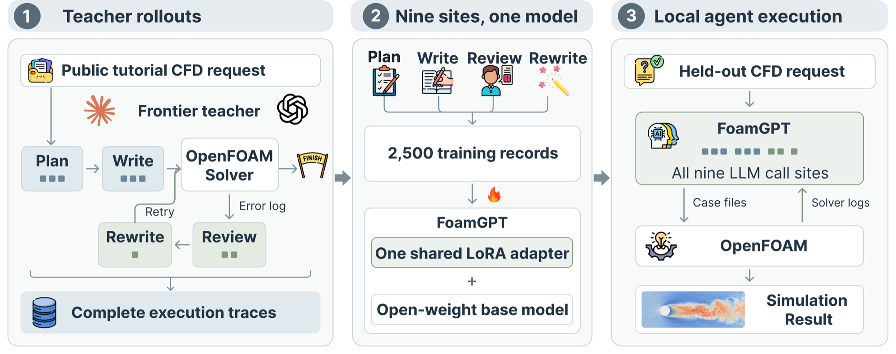

<div align="center">

# FoamGPT: Fine-Tuning Large Language Models for Agentic Automation of CFD Simulations with OpenFOAM

<!-- TODO: replace XXXX.XXXXX with the arXiv ID once the paper is posted -->
[](https://arxiv.org/abs/XXXX.XXXXX) [](https://huggingface.co/ghzlmc/foamgpt) [](https://huggingface.co/datasets/ghzlmc/foamgpt) [](https://ml4physicalsciences.github.io/2025/files/NeurIPS_ML4PS_2025_271.pdf) [](LICENSE)

</div>

FoamGPT runs an OpenFOAM simulation agent on a **local open-weight model**. A frontier teacher (Claude Opus 4.6) drives [Foam-Agent](https://github.com/csml-rpi/Foam-Agent) through public tutorial cases, and every call it makes is recorded, including error diagnosis and repair. **One LoRA adapter** trained on these traces lets a 26B–30B open-weight model serve **all nine LLM call sites** of the agent on a single node, so no case data leaves the machine.

<p align="center">
  
</p>

## News

<!-- TODO: dates -->
- **[2026-10]** Paper on arXiv; code, data, and adapters released.
- **[2025-12]** The first FoamGPT paper appeared at the NeurIPS 2025 ML4PS workshop; its code is in [`workshop2025/`](workshop2025/).

## Results

Success rate on 33 held-out FoamBench cases: new parameter values of the 11 training case families. A case succeeds when the solver finishes with finite fields within ten attempts.

| Model | Size | Open weights | Success (%) |
|---|---:|:---:|---:|
| GPT-6 Sol | – | | 66.7 |
| **FoamGPT-Nemotron** (ours) | 30B | ✓ | **47.5** |
| DeepSeek-V4.1, untuned | 552B | ✓ | 30.3 |
| **FoamGPT-Gemma4** (ours) | 26B | ✓ | 29.3 |
| GPT-6 Luna | – | | 21.2 |
| Qwen3.8, untuned | 125B | ✓ | 21.2 |
| Nemotron-Nano, untuned | 30B | ✓ | 0.0 |

Splitting the same training data across three adapters, by pipeline stage or at random, lowers the success rate to 34.3–43.4%. The paper also reports field fidelity, the 16 out-of-distribution Advanced cases, and which call sites carry the gain.

## What is released

| Resource | Where | Contents |
|---|---|---|
| Adapters | [🤗 ghzlmc/foamgpt](https://huggingface.co/ghzlmc/foamgpt) | Shared adapters for Nemotron-3-Nano-30B-A3B and Gemma4-26B-A4B; the split and scaling adapters for Nemotron |
| Teacher traces and splits | [🤗 dataset](https://huggingface.co/datasets/ghzlmc/foamgpt) → `data/` | 4,117 Claude Opus 4.6 calls from 126 Foam-Agent runs, repair rounds included; 2,647 training records (variants 1–7) and 1,050 held-out records (variants 8–10) |
| Evaluation cases | [`dataset/`](dataset/) | Prompts of the 33 held-out Basic cases and 16 Advanced cases from FoamBench; their reference solutions come from the 🤗 dataset |
| Retrieval indexes | [🤗 dataset](https://huggingface.co/datasets/ghzlmc/foamgpt) → `code/database/faiss/` | The agent's FAISS indexes over the OpenFOAM tutorials |
| Per-case results | [`results/`](results/) | Every system in the paper; [`results/README.md`](results/README.md) maps each file to its table or figure |

## Installation

Requirements: 4 GPUs with at least 80 GB each, [OpenFOAM 10](https://openfoam.org/version/10/), and Python 3.12.

```bash
git clone https://github.com/csml-rpi/FoamGPT.git && cd FoamGPT

# vLLM 0.20.1 serves Nemotron; vLLM 0.31.0 serves the Qwen3.8 and DeepSeek baselines
python3.12 -m venv ~/venvs/vllm020 && ~/venvs/vllm020/bin/pip install -r scripts/requirements-vllm0.20.1.txt
python3.12 -m venv ~/venvs/vllm031 && ~/venvs/vllm031/bin/pip install -r scripts/requirements-vllm0.31.0.txt
source ~/venvs/vllm020/bin/activate                    # provides the hf command used below

scripts/download_data.sh                               # traces, reference solutions, retrieval indexes
scripts/fetch_models.sh ~/models nano embedder         # base model at the pinned revision, retrieval embedder
hf download ghzlmc/foamgpt --local-dir ~/adapters      # fine-tuned adapters

# write the machine-specific paths into the configs
python3 scripts/localize.py --models-dir ~/models --openfoam-bashrc /opt/openfoam10/etc/bashrc \
    --venv020 ~/venvs/vllm020 --venv031 ~/venvs/vllm031 --adapters-dir ~/adapters
```

## Quick start

Evaluate FoamGPT-Nemotron on the 33 held-out cases, then score the run:

```bash
scripts/run_benchmark.sh E32_UNIFIED 1
```

One run takes 18–26 hours on a node with four A100 GPUs. Running the same command again resumes an interrupted run. Transcripts, case directories and scores are written to `code/experiment-finetuned/E32_UNIFIED_holdout_run1/`.

## Reproducing the paper

### Training

```bash
cd training
gunzip -k ../data/train.jsonl.gz ../data/test.jsonl.gz
python finetune_nemotron_unified.py --train ../data/train.jsonl --test ../data/test.jsonl --output nemotron-shared
python finetune_gemma4_26b_a4b_unified.py --train ../data/train.jsonl --test ../data/test.jsonl
```

Both scripts train one rank-16 LoRA adapter for three epochs on all nine call sites. The split and scaling adapters use the same script on subsets of the data. Settings and environments are in [`training/README.md`](training/README.md).

### Evaluation

Each system is a config that maps every call site to a model or adapter; `scripts/localize.py` writes them for your machine.

| System in the paper | Run |
|---|---|
| FoamGPT-Nemotron (Table 1) | `scripts/run_benchmark.sh E32_UNIFIED <run>` |
| Untuned Nemotron-Nano, Nemotron-Super, Qwen3.8, DeepSeek-V4, DeepSeek-V4.1 (Table 1) | The same command with `BASE_NANO`, `E33_SUPER_BASE` and `E37_SUPER_NOSTRIP`, `E46_QWEN38_NOSTRIP`, `E47_DSV4F_NOSTRIP`, `E48_DSV41F_NOSTRIP` |
| FoamGPT-Gemma4 (Table 1) | Merge the adapter into `unsloth/gemma-4-26b-a4b-it` with PEFT and serve the merged model |
| Shared vs. split adapters (Table 2) | `SPLIT_STAGE_SPECIFIC`, `SPLIT_RANDOM_R1`, `SPLIT_RANDOM_R2`, `SPLIT_RANDOM_R3` |
| Base model at one call site (Figure 3) | The shared-adapter config with one call site's adapter removed |
| Advanced cases (Table 3) | Add `--advanced` to the command |

Run `python3 scripts/score_run.py <ID>_holdout_run<k>` to score a finished run again.

<details>
<summary>Evaluation protocol</summary>

Keep these settings for numbers comparable to the paper: temperature 0.6, a 100,000-token context, a 16,384-token output cap per call, at most ten solver attempts, one sequence at a time, eager mode, and tensor parallelism 4. A case succeeds when the solver log ends in `End`, the final time step is written, and all fields are finite. Crashes and malformed output count as failures. The configs of runs that cleaned each answer at its last `final` marker (the shared and split adapters, `E33_SUPER_BASE`) set `FOAMGPT_STRIP_FINAL=1`.

</details>

## Repository structure

```
assets/        Figures for this README
code/          Agent harness adapted from Foam-Agent, benchmark runners, scoring scripts
configs/       Model maps for every system, split-adapter maps, chat templates
data/          Manifests and scaling subsets; download the traces and splits into this folder
dataset/       Prompts of the evaluation cases; download the reference solutions into this folder
docs/          Audit of the reference solutions
results/       Per-case results for every system in the paper
scripts/       Download, setup, run and scoring scripts; serving environments
training/      Fine-tuning scripts and environments
workshop2025/  Code of the NeurIPS 2025 ML4PS workshop version
```

## Citation

```bibtex
@article{wang2026foamgpt,
  title   = {FoamGPT: Fine-Tuning Large Language Models for Agentic Automation of CFD Simulations with OpenFOAM},
  author  = {Wang, Jiaying and Zhu, Mingzhi and Yue, Ling and Xu, Peijing and Zhang, Tingwen and Somasekharan, Nithin and Zeng, Yadong and Xu, Hang and Di, Shimin and Pan, Shaowu},
  journal = {arXiv preprint arXiv:XXXX.XXXXX},
  year    = {2026}
}

@inproceedings{yue2025foamgpt,
  title     = {FoamGPT: Fine-tuning Large Language Model for Agentic Automation of CFD Simulations with OpenFOAM},
  author    = {Yue, Ling and Xu, Peijing and Zhang, Tingwen and Somasekharan, Nithin and Pan, Shaowu},
  booktitle = {Machine Learning and the Physical Sciences Workshop, NeurIPS},
  year      = {2025}
}
```

## License and acknowledgments

The code is released under the [MIT License](LICENSE). `code/` is adapted from [Foam-Agent](https://github.com/csml-rpi/Foam-Agent) (MIT), and the evaluation cases come from FoamBench in [CFDLLMBench](https://arxiv.org/abs/2509.20374) (BSD 3-Clause, [`dataset/LICENSE`](dataset/LICENSE)). The adapters follow the licenses of their base models. The teacher traces are outputs of Claude Opus 4.6 obtained through Amazon Bedrock and are subject to Anthropic's terms of service; they are released for research use.
